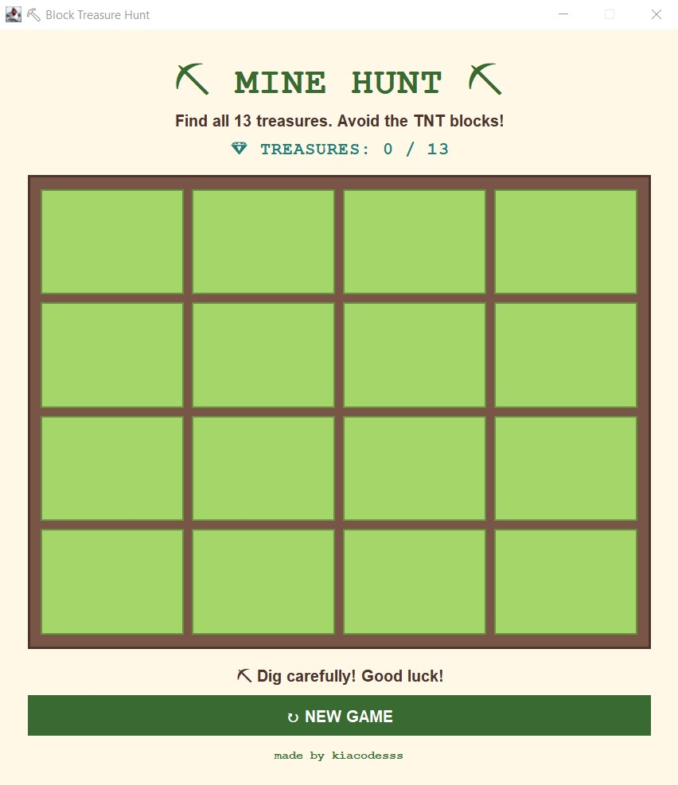
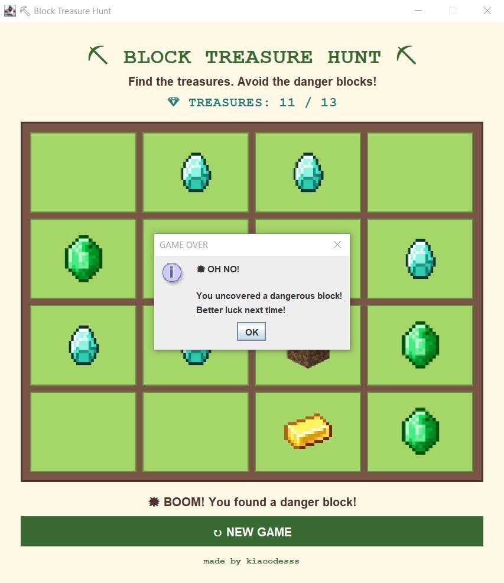

# ⛏  Mine Hunt
> A Minecraft-inspired Java Swing treasure-hunting game where you collect hidden treasures while avoiding dangerous blocks.

---

## 📌 About the Game

**Mine Hunt** is a Minecraft-inspired treasure-hunting game built with Java Swing. Explore a 4×4 grid of blocks, uncover hidden treasures, and try to collect them all while avoiding dangerous blocks.

---

## 👀 Preview

<div align="center">

<h3>Mine Hunt Game Preview</h3>

<table>
  <tr>
    <td align="center">
      
    </td>
    <td align="center">
      
    </td>
  </tr>
</table>

</div>

---

## ✨ Features

- Minecraft-inspired interface
- 4 x 4 interactive game board
- 13 hidden treasures
- Diamond, gold, and emerald treasures
- TNT, dirt, and stone blocks
- Randomized block placement
- Treasure counter
- Click-to-reveal system
- Win and lose conditions
- Reset button
- Victory and game-over messages

---

## 🧩 Key Systems

### 🎮 Game Logic
- Randomized treasure and block placement
- Click-to-reveal block system
- Treasure collection tracking
- Win detection after collecting all 13 treasures
- Game-over detection when a dangerous block is revealed

### 💎 Treasure System
- Tracks collected diamonds, gold, and emeralds
- Updates the treasure counter after each discovery
- Displays progress as 0 / 13

### 💥 Hazard System
- TNT triggers the game-over condition
- Dirt and stone are non-treasure blocks
- Disables further gameplay after losing

### 🖥️ Graphical User Interface
- Built using Java Swing
- Custom Minecraft-inspired block icons
- Interactive 9×9 grid
- Treasure counter and game status display
- Reset button for starting a new game

---

## 🛠️ Technologies Used

| Technology | Purpose |
|---|---|
| **Java** | Core game logic and application programming |
| **Java Swing** | Graphical user interface |
| **Apache NetBeans** | Development environment |
| **Git & GitHub** | Version control and project distribution |
| **ChatGPT** | Troubleshooting and development assistance |

---

## 🚀 Running from Source

### Requirements

- Java JDK 25
- Apache NetBeans IDE 28 (recommended)
- Windows operating system

### Steps

1. Clone the repository:

   ```bash
   git clone https://github.com/kiacodesss/mine-hunt-game.git
   ```
   
2. Open the project in NetBeans.
3. Allow NetbBeans to load and configure the project.
4. Clean and build the project in NetBeans.
5. Run the application.

---

## 📦 Release

A ready-to-run version is available under **GitHub Releases**.

**[Download Mine Hunt for Windows](../../releases/latest)**

The included JAR file contains the compiled **Mine Hunt** application and can be used to
run the game without opening the project in NetBeans.

---

## 🎓 Project Information

**Mine Hunt** was developed as an academic project for the **Intermediate Programming** course.

The project demonstrates the application of **Java programming, object-oriented programming, GUI development, event handling, and game logic** using **Java Swing and NetBeans**.

This repository contains the **revised and upgraded version of Mine Hunt**, featuring improved gameplay, visuals, and overall user experience.

---

## 📄 License

This project is for educational and portfolio purposes.
